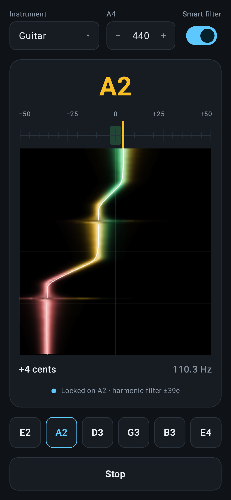
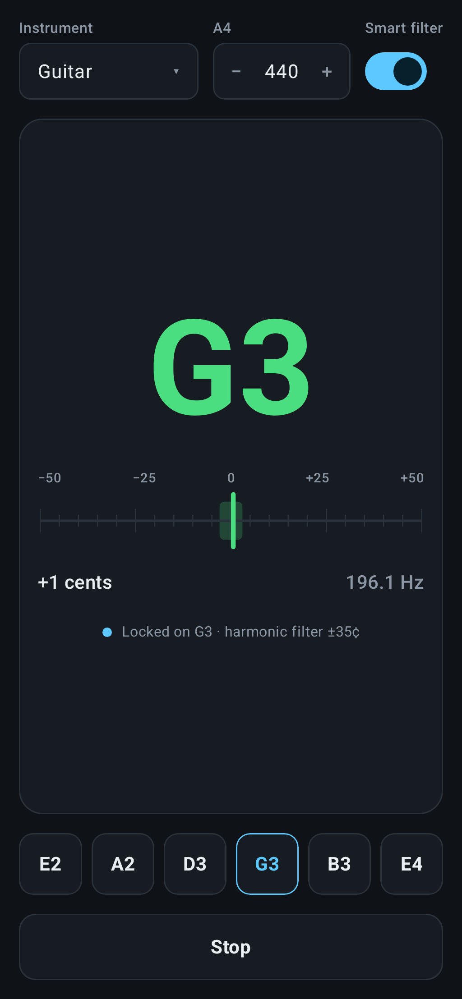

# Tuner

An instrument tuner for Android that listens through the phone microphone,
with a **smart filter**: after it has heard a steady note it locks onto that
string and filters the input with a harmonic comb built for it, which keeps
the reading stable and accurate in noise and makes octave errors impossible.

Native Kotlin, Jetpack Compose. See [docs/ARCHITECTURE.md](docs/ARCHITECTURE.md)
for how it works.

<p>
  
  
</p>

## Build

Open the folder in Android Studio and run the `app` configuration, or from a
terminal with the Android SDK installed (`ANDROID_HOME` set, or `sdk.dir` in
`local.properties`):

```sh
./gradlew :app:installDebug   # build and install on a connected phone
./gradlew test                # engine + app unit tests (no device needed)
./gradlew :app:validateDebugScreenshotTest   # UI against the reference images
```

Requires Android 8.0 (API 26) or newer.

| Module | What it is |
| --- | --- |
| `engine` | The tuner: DSP, instruments, search/lock logic. Pure Kotlin, tested on the JVM. |
| `app` | The Android app: microphone capture and the Compose UI. |

## Use

1. Tap **Start tuner**, allow the microphone, and pluck a string. With the
   instrument on **Automatic** (the default) the tuner starts out chromatic
   and recognises the instrument once it has heard two different strings; you
   can also pick the instrument yourself.
   | Instrument | Two strings that set it |
   | --- | --- |
   | Guitar, bass, ukulele, cello | any two |
   | Violin | the E string and any other |
   | Viola | the C string and any other |

   (A violin and a viola share G, D and A, so those alone cannot tell them apart.)
2. The tuner shows the note wide-band, then locks ("Locked on A2 · harmonic
   filter ±35¢") once the note is steady. Pluck another string and it follows.
3. Tap a string button to pin the tuner to it (useful for a string that is far
   off, or in a noisy room). Tap again to release.
4. The **Smart filter** switch turns the automatic locking off.
5. While the tuner is stopped, the gear button (where the Smart filter switch
   is while it runs) opens **Settings**:
   - *Waterfall*: the history under the meter as a colour spectrogram or as a
     plain line.
   - *Needle response*: Fast, Normal or Steady, which is how long the needle
     averages the reading (0.1, 0.2 or 0.4 s).
   - *Tunings*: switch the standard tunings on and off (Automatic only chooses
     among those that are on), or **Duplicate** one and edit the copy's name,
     notes and number of strings to make your own.
