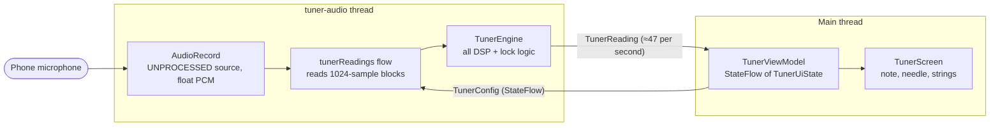
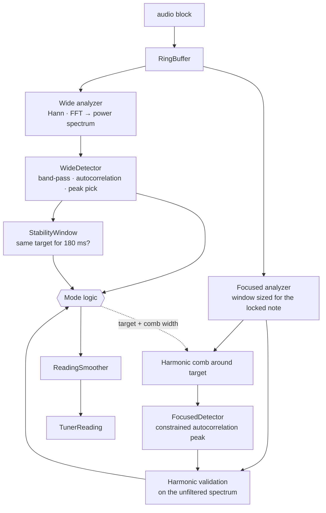

# Tuner architecture

An Android tuner that listens through the phone microphone. Its distinguishing
feature is the **smart filter**: once it knows which note you are tuning to, it
stops treating the input as "any sound" and starts treating it as "a string
that should be close to this note", which lets it filter and measure far more
aggressively.

- [1. Shape of the system](#1-shape-of-the-system)
- [2. Module map](#2-module-map)
- [3. Signal path](#3-signal-path)
- [4. The smart filter](#4-the-smart-filter)
- [5. Automatic switching](#5-automatic-switching)
- [6. Tunables](#6-tunables)
- [7. What has been verified](#7-what-has-been-verified)
- [8. Limits and next steps](#8-limits-and-next-steps)

## 1. Shape of the system

A native Android app in Kotlin, in two Gradle modules:

- **`:engine`** — the tuner itself: DSP, instrument knowledge, and the
  search/lock logic. Pure Kotlin with no Android dependency, so the whole of
  it is unit-tested on the JVM. Its API is one call:
  `TunerEngine.process(block) → TunerReading`.
- **`:app`** — the Android shell: microphone in, Jetpack Compose UI out.

Two threads, each with one job:



- The **audio thread** blocks on `AudioRecord.read`, runs the engine on each
  block, and emits the reading. The engine is single-threaded by design and
  lives entirely here.
- The **main thread** only holds state and draws. Readings are queued for it,
  and if it ever falls more than about a second behind, the oldest are
  dropped: a slow frame on the UI side never makes analysis wait.
- Configuration travels the other way as an immutable `TunerConfig` in a
  `StateFlow`; the audio loop compares it between blocks. No locks anywhere.

The pipeline is a cold `Flow` (`tunerReadings` in `TunerPipeline.kt`).
Collecting it opens the microphone; cancelling the collection closes it. That
makes the lifecycle hard to get wrong: the view model starts a collection on
"Start" and cancels it on "Stop" or when the app leaves the screen.

### Getting clean audio out of a phone

Phones process microphone audio for speech by default, and that processing is
poison for a tuner: noise suppression regards a sustained string as background
noise and removes it, and automatic gain control pumps the level.
`MicrophoneSource` therefore:

- records from `MediaRecorder.AudioSource.UNPROCESSED` when the device
  supports it, otherwise from `VOICE_RECOGNITION` (the least-processed source
  every device has to provide);
- explicitly switches off any `NoiseSuppressor`, `AutomaticGainControl` or
  `AcousticEchoCanceler` the device still attaches to the recording session;
- reads float PCM at 48 kHz (falling back to 44.1 kHz), mono.

This control over the input is the main reason the app is native rather than a
web page: browsers only *request* that processing be turned off.

### What the screen shows

- **The meter**: a ±50 cent scale with a needle, coloured by how close the
  string is.
- **The waterfall** under it: the last eight seconds on the same horizontal
  scale, newest at the top and moving down, in one of two styles chosen in the
  settings.
  - *Spectrogram* (the default): each row is the string's spectrum with the
    noise floor removed, drawn as light on black. Colour says where on the
    scale it is (green in tune, through yellow, to red far off) and brightness
    says how much energy is there. A clean note lights a narrow stripe, a
    stiff or dying one a wider and fainter one, a second string a second
    stripe, and silence is black. The tuner's reading runs through it as a
    thin white line. For contrast, brightness is shaped in two parts: within a
    row it rises exponentially towards the row's peak (half the peak's level
    is drawn at 8 %), so a clear peak is a clear line and the wide faint
    skirts around it do not haze over the scale; and quiet rows are lifted, so
    a note that has faded to a tenth of full level still shows.
  - *Line*: only the reading, in the colour the needle had at each moment.

  Either way, something running straight down is a steady pitch and something
  slanted is a pitch that is changing, so the player sees how far a turn of
  the peg moved the string and whether a note drifts as it rings. The picture
  belongs to one string and starts over when the tuner moves to another.
- **The note name**: large while the tuner is chromatic (it is then the main
  information), small once the instrument is known, because the row of string
  buttons already highlights which string is sounding.

A second screen, **Settings**, holds the waterfall style and the list of
tunings: every standard tuning with a switch that puts it in or out of use,
and a *Duplicate* button that makes an editable copy (name, the note of each
string, more or fewer strings). Only the tunings in use appear in the
instrument picker and are candidates for automatic recognition. Changes apply
at once, also to a running tuner, and are saved.

## 2. Module map

```
engine/src/main/kotlin/io/github/alfonslm/tuner/
  engine/
    TunerEngine.kt          orchestration + search/locked state machine
    StabilityWindow.kt      "has one note been sounding steadily?"
    ReadingSmoother.kt      median + exponential smoothing, in-tune detection
    RingBuffer.kt           recent audio history
    TunerConfig.kt          every tunable, with defaults
    TunerReading.kt         what the engine reports per block
  dsp/
    Fft.kt                  radix-2 FFT
    Spectral.kt             windowed power spectrum → filtered autocorrelation
    WideDetector.kt         note-agnostic pitch detector (acquisition, watchdog)
    HarmonicComb.kt         string model: comb filter + harmonic validation
    SpectralHistory.kt      what was sounding before the last pluck, to take it away
    FocusedDetector.kt      target-aware pitch detector (tracking)
    FoldedSpectrum.kt       one row of the spectrogram: partials folded onto a cents scale
  music/
    Notes.kt                Hz ↔ MIDI ↔ names, cents
    Instruments.kt          the standard tunings: strings + harmonic model each
    InstrumentIdentifier.kt automatic mode: which instrument do these strings belong to?
    Targets.kt              TargetSet: the notes the tuner snaps to
engine/src/test/            synthetic plucked strings, DSP and engine scenarios

app/src/main/kotlin/io/github/alfonslm/tuner/app/
  audio/AudioSource.kt      interface: something that delivers audio blocks
  audio/MicrophoneSource.kt AudioRecord implementation (see above)
  TunerPipeline.kt          AudioSource + config → Flow<TunerReading>
  TunerViewModel.kt         UI state, start/stop, settings changes
  PitchTrace.kt             the last 8 s of spectrogram rows and readings
  Tunings.kt                the user's tuning list: switch, duplicate, edit, save
  Settings.kt               persisted choices (SharedPreferences)
  MainActivity.kt           permission, lifecycle, keep-screen-on
  ui/TunerScreen.kt         the tuner screen
  ui/SettingsScreen.kt      waterfall style and the tuning list
  ui/Meter.kt               the cents scale and needle
  ui/Waterfall.kt           the history under the meter, as spectrogram or line
  ui/Theme.kt               colours
app/src/test/               the pipeline driven by a synthetic microphone
```

Dependencies point one way: `ui → view model → pipeline → engine → dsp, music`.
The app reaches the microphone only through the `AudioSource` interface, which
is what lets the tests replace it with a generated signal.

## 3. Signal path

Every block (1024 samples, ≈21 ms) the engine does this:



Both detectors share one idea, implemented in `dsp/Spectral.kt`:

> pitch = position of the autocorrelation peak, where the autocorrelation is
> computed as `IFFT(power spectrum × weights)`.

The **weights are the filter**. The wide detector uses a band-pass over the
instrument's range. The focused detector uses a harmonic comb. Filtering in
the power-spectrum domain costs one multiplication per bin, is zero-phase, and
can be redesigned every frame for free — which is what lets the comb follow
the string as it is tuned.

Two details make the result accurate to a fraction of a cent:

- the frame is shorter than the FFT, so the autocorrelation never wraps around;
- the result is divided by the window's own autocorrelation, otherwise the
  taper drags every peak towards shorter lags (several cents sharp on low notes).

## 4. The smart filter

### What we know before measuring

A string produces partials at near-integer multiples of its fundamental,
stretched slightly by stiffness:

```
f_k = k · f0 · √(1 + B·k²)        k = 1, 2, 3 …
```

`B` (inharmonicity) and the number of useful partials come from the instrument
preset (`HarmonicModel`). And when tuning, `f0` is close to a known target.
So of the whole spectrum, only narrow regions around `k · f_target` can contain
the string. Everything else is, by definition, something else.

### The comb

`buildComb()` creates one pass band per partial:

```
gain
 1 ┤   ┌──┐
   │   │  │        ┌──┐                       band k is centred on f_k(target)
 ¼ ┤   │  │        │  │        ┌──┐           flat over ± widthCents, cosine edges
   │   │  │        │  │        │  │    …      weighted 1/k²
 0 ┼───┴──┴────────┴──┴────────┴──┴─────► Hz
       f1          f2          f3
```

- **Flat top of ± `widthCents`**: a string that is that far off passes
  undistorted, so the filter itself never biases the reading.
- **1/k² weighting**: in an autocorrelation, a partial pulls on the peak
  position in proportion to its power × k². Undoing that keeps the stretched
  upper partials of a stiff string from dragging the reading sharp.
- Bands are padded by the analysis window's main-lobe width; narrower than
  that is physically meaningless for a frame of that length.

### What the lock buys

| Knowing the target lets us… | Effect |
| --- | --- |
| remove everything between the partials | hum, room noise, speech and other strings never reach the estimator |
| search only lags near the target period | octave errors — the classic tuner failure — become impossible |
| size the window for this one note (120 to 150 ms) | fine enough to keep the partials of *other* strings out of each pass band |
| narrow the comb as the string approaches | maximum selectivity exactly when the last few cents matter |

### Keeping it honest

A comb makes *any* input look periodic at the target, so every focused
estimate is checked against the **unfiltered** spectrum (`harmonicProfile()`).

The check must not ask "is this the only thing sounding?". While tuning it
never is: the strings plucked a moment ago are still ringing. It asks four
narrower questions, and a reading is valid if all four are answered well:

| Check | Question | Rejects |
| --- | --- | --- |
| `prominence` | Do the partials stand out of the noise floor? (Energy on them, in multiples of what the floor alone would put there.) | silence, noise, a note that has died away |
| `explained` | Is the string the main thing in its band? (At least 45 % of the tonal energy.) | a string that has faded below the others |
| `fundamentalSupport` | Is there energy on partials that are *not* multiples of 2, 3, 5, 7? | a note an octave (or twelfth…) *above* the target, all of whose partials fit the comb, e.g. E4 while locked on E2 |
| `subharmonic` | Is there less energy *between* the partials, where those of a note 2, 3 or 4 times lower would lie, than on them? | a lower string whose overtone lands on the target, e.g. E2 while locked on E4 |

The last limit is lenient (as much energy between the partials as on them),
because that is also where the partials of other ringing strings fall. A
pinned string uses a stricter one, since nothing else then guards it.

### Strings that are still ringing

On a guitar the low E and the A string are exact sub-octaves of the high E:
82.4 × 4 and 110 × 3 are both 330 Hz. Pluck the high E while either still
rings and the combined sound repeats at the *lower* string's period. In a
single frame that is indistinguishable from the lower string alone with weak
overtones. An analysis of one frame at a time has to guess, and whichever way
it leans, it is wrong for one of the two.

What tells them apart is time: a ringing string only fades, the plucked one
appears. `SpectralHistory` uses that.

- It keeps a short run of recent spectra (half a second). The share of the
  current spectrum that stands well above their average is the **novelty**;
  it is near zero for anything steady or fading, noise included, and jumps
  when a note starts. A jump is a pluck.
- At a pluck, the least each bin has held over that run becomes **the
  background**: what was sounding before.
- From then on both detectors look first at the spectrum with the background
  taken away. The strings that were already ringing are gone from it; the new
  one is nearly intact (in the tests: under 5 % of the old string left, over
  95 % of the new one kept). Only if that gives no clear note do they fall
  back to the whole sound.
- The background fades out over about 1.5 s. The strings it stands for are
  dying away too, and taking away more than is really still there would eat
  into the new string's partials where the two lie close.

The focused detector, which is created after the pluck that led to its lock,
gets its background from the last second of audio still in the buffer.

Two further things make a mixture easier:

- **Window length.** Every focused window is at least 120 ms, which resolves
  17 Hz. Shorter windows had been used for high strings, but what crowds a
  high string is not its own partials: the second partial of a D string lies
  36 Hz below a high E, and inside a 50 ms window's reach it pulled the
  reading flat by 6 cents at a level 12 dB below the E.
- **The wide detector's choice of period.** It takes the shortest period that
  is at least 65 % as good as the best, not 90 %, so a quieter string an
  octave or two below does not win merely because its period fits both.

### The spectrogram

The waterfall needs a spectrum on the meter's scale: ±50 cents around the
target. Taken naively that is hopeless. At 82 Hz, ±50 cents is ±2.4 Hz, far
below what any window of practical length resolves; the row would be one
smear. `FoldedSpectrum` gets a usable picture out of ordinary spectrum
analysis with two moves:

- **Fold the partials.** Every partial carries the same pitch information, and
  partial k is k times sharper on a cents scale, because the window's
  resolution is fixed in Hz while a cent at partial k is k times as many Hz.
  The neighbourhoods of all partials are mapped onto one cents axis and added.
  A partial counts for more the sharper it is (k²) and the stronger it is (its
  amplitude relative to the strongest), so the picture follows the frequencies
  that carry the sound and a faint overtone cannot pull it aside.
- **Use a long window.** 48 periods of the target (capped at 0.6 s) instead of
  the detectors' 16. A history display can afford the delay: each row is dated
  at the middle of its window, about a quarter of a second back, which is a
  few pixels of an eight-second waterfall. The needle is not affected.

The **noise floor is removed per partial**: the floor is the median power in
that partial's own neighbourhood, and only power above three times that
counts, so hum and rumble near one partial do not lift the floor anywhere
else. A partial is drawn only once its peak stands 10 dB clear. The row as a
whole is scaled by how far the strongest partial is above the noise, so a note
that fades away fades from the display.

With all eight partials present the stripe is about 9 cents wide. It is wider
when the sound gives less to go on: only low partials left, overtones that
disagree, a pitch that moved within the window. Nothing in the row is derived
from the pitch estimate; the stripe and the needle are two independent views
of the same sound. On a string much stiffer than its preset assumes they can
sit a few cents apart, because the stripe is dominated by the upper partials
and the reading deliberately is not.

A row is produced every third block (about 16 per second) and travels in
`TunerReading.spectrum`.

### One time axis

Results come out later than the sound they describe, and by different
amounts. A reading describes the middle of its analysis window and is then
smoothed (a median of three frames and an exponential average, kept short so
the needle follows the peg): about 0.11 s in all for a guitar's A string. A
spectrogram row describes the middle of a much longer window: about 0.25 s.

Drawn at the time they were produced, the reading would run beside the stripe
whenever the pitch moves, not through it. So both carry the time of their
audio: a row in `SpectrumRow.time`, a reading as `TunerReading.delay` behind
`time`. The waterfall places everything at audio time, and its top edge is the
moment the newest reading describes, which is what the needle is showing. The
spectrogram therefore starts a little below the top; it needs more sound
before it can say anything.

## 5. Automatic switching

Two automatic modes plus a manual pin. The wide detector runs in both automatic modes: as the source of readings while
searching, as a watchdog while locked.


While locked, the target can change without leaving the mode: the lock moves
when another note becomes steady, and hands off to the neighbouring target
when the string is tuned past the midpoint between them.

**Search → Locked.** `StabilityWindow` watches the wide detector. When every
frame in the last `stableMs` (180 ms) is clearly pitched, maps to the same
target, and wanders less than `maxSpreadCents`, that target is "the correct
note": the lock engages and the comb opens just wide enough to contain the
string's current offset. Until then the wide-band reading is shown, so the
display is never blank while the decision is being made.

**While locked**, per frame, in this order (`TunerEngine.trackLocked`):

1. Focused estimate valid → use it, unless the wide detector steadily names
   another string *and* that is a new note. Whether it is depends on how the
   two relate:
   - an **overtone** of the locked string: usually the wide detector's own
     octave error, and ignored; believed only if little energy is left on the
     locked string's other partials (the higher string has been plucked while
     this one rings on);
   - a note the locked string is **an overtone of**: with both ringing, their
     common period is the lower one's, so the wide detector says that;
     believed only if that string has just been plucked;
   - **unrelated**: believed.
2. Focused estimate invalid and the wide detector steadily on a different
   target → move the lock there at once (plucking the next string re-targets
   in about a third of a second).
3. Focused estimate invalid but the wide detector hears something inside the
   capture range → show the wide reading against the locked target (covers a
   string that jumped out of the narrowed comb).
4. Otherwise show nothing. The lock is *held* through silence so re-plucking
   the same string is tracked from the first frame; after `holdMs` (2.5 s)
   the tuner returns to Search.

**Comb width** (`adaptComb`): `|current offset| + marginCents`, bounded by the
target's capture range. It opens instantly, closes gradually, and re-opens
fully after a few frames without a reading.

**Capture range** (`TargetSet.captureCents`): half the distance to the nearest
neighbouring target plus a small overlap — ±80 cents in chromatic mode,
±230–280 cents between guitar strings. The overlap gives hysteresis for the
hand-off when a string is tuned past the midpoint, so the target never flaps.

**User control**

| Control | Config | Behaviour |
| --- | --- | --- |
| Smart filter switch | `smartFilter: AUTO \| OFF` | `AUTO` (default) switches as described. `OFF` stays wide-band always. |
| Tap a string | `pinnedTargetId` | Forces the lock onto that string with a ±400-cent capture range and ignores every other note. For strings that are far off (new strings) or noisy rooms. Tap again to release. |

| Instrument: Automatic | `instrumentId: "auto"` | The default. Works out the instrument from the strings played; see below. |

Every `TunerReading` carries `mode`, `source` (`WIDE` / `FOCUSED`) and the
lock's target and comb width, so the UI can show exactly what the filter is
doing.

### Recognising the instrument

The default instrument is **Automatic**: the player should not have to say
what they are holding, because the strings give it away. It chooses among the
tunings in use (`TunerConfig.tunings`), which the user controls in the
settings: by default one per instrument (guitar, bass, ukulele, violin, viola,
cello). The alternates that ship with the app (Drop D, half step down, DADGAD,
Open G, 7-string, 5-string bass, mandolin, banjo) start switched off, because
a tuning that shares most strings with another makes recognition wait for the
string that differs. Custom tunings are candidates like any other.

One string says little — G3 is on a guitar, a violin and a viola. Two
different strings almost always settle it, because instruments differ both in
register and in the interval between neighbouring strings (fourths on a guitar
or bass, fifths in the violin family).

1. Until the instrument is known, the engine behaves as a chromatic tuner
   whose range spans the tunings in use (E1 to C6 by default). It is fully usable in this
   state: notes are shown and locked onto as semitones.
2. Each time a note settles (the same trigger that engages the lock), its
   pitch goes to `InstrumentIdentifier`. That keeps the two most recent
   *distinct* pitches and asks of every preset: could these be two different
   strings of yours, each within 150 cents of where it belongs? The fit is the
   RMS distance in cents.
3. If exactly one instrument fits, or the best fits at least 40 cents better
   than the runner-up, it is chosen. The engine rebuilds itself around that
   instrument's strings and harmonic model, and the lock carries over to the
   string that is still sounding. `TunerReading.instrumentId` reports the
   change; the UI shows the instrument and its string buttons appear.

From then on the tuner has what chromatic mode lacks: it knows a D string a
whole tone flat is a flat D string, not an in-tune C.

It is deliberately reluctant. A pair that fits two instruments stays undecided
until a string only one of them has is played (violin and viola share G3, D4
and A4). Only the last two pitches count, so one misheard note is forgotten as
soon as two good ones follow. A choice, once made, holds until the tuner is
stopped or the user picks an instrument; picking Automatic again starts over.

## 6. Tunables

All in `engine/TunerConfig.kt`, as defaults of an immutable data class. The
ones that shape behaviour:

| Setting | Default | Meaning |
| --- | --- | --- |
| `lock.stableMs` | 180 | how long a note must hold before the filter engages |
| `lock.maxSpreadCents` | 30 | how steady it must be during that time |
| `lock.holdMs` | 2500 | silence tolerated before unlocking |
| `focus.marginCents` | 35 | comb half-width when the string is in tune |
| `focus.minFrameMs` / `maxFrameMs` | 120 / 150 | focused analysis window |
| `focus.minProminence` / `minExplained` / `minFundamentalSupport` / `maxSubharmonic` | 12 / 0.45 / 0.06 / 1.0 | validation thresholds |
| `wide.minClarity` / `peakPickRatio` | 0.75 / 0.65 | periodicity needed for a wide-band reading; how readily a shorter period is preferred |
| `fresh.memoryMs` / `fadeMs` / `onsetRise` | 500 / 1500 / 0.25 | hearing a plucked string apart from ringing ones |
| `display.medianFrames` / `smoothing` | 3 / 0.5 | how hard the reading is smoothed; lower `smoothing` is steadier and slower |
| `display.inTuneCents` / `inTuneHoldMs` | 3 / 400 | when the display turns green |

The standard tunings live in `music/Instruments.kt` (string notes + harmonic
model each); adding one there is one entry. The user's own are made in the
app and reach the engine the same way, as entries of `TunerConfig.tunings`.

## 7. What has been verified

`./gradlew test` needs no device. It runs:

- **64 engine tests** against a plucked-string synthesizer (inharmonic
  partials with individual decay, weak fundamental, white noise, mains hum):
  - each guitar string is identified, locked within 0.5 s of the pluck, and
    read to within 0.3 cent;
  - on a stiff string (B = 10⁻⁴) the wide detector reads about 3 cents sharp,
    the focused detector under 1;
  - in noise where wide-band detection fails on more than 15 of 20 trials, the
    focused detector is right on at least 19;
  - noise and silence never produce a reading; every other string of the
    instrument is rejected even with the comb fully open;
  - E2 ↔ E4, string changes, chromatic hand-off through a semitone, hold and
    release, and pinning behave as described above;
  - with the six strings plucked one after another and all left ringing, 2 s
    or 1.2 s apart, every string is followed for the whole of its time and
    read to within 3.5 cents (measured: within 1.5);
  - the high E is read to within 1.5 cents over a ringing low E, A or B at
    12, 6 and 3 dB below it, and the tuner goes to the low E when that is
    plucked over a ringing high E;
  - a pitch moving at 30 cents a second is trailed by the needle by 2 to 4.5
    cents (about 0.11 s), and every reading is within 0.7 cent of the truth at
    the moment it says it describes;
  - the spectrogram: a string shows as a stripe at most 11 cents wide within
    1 cent of where it is, on every string; noise, silence and mains hum leave
    the row empty; two strings 30 cents apart show as two stripes;
  - automatic mode: every pair of strings of every preset identifies its
    instrument (or stays undecided where two instruments share the pair), and
    the engine recognises guitar, bass, ukulele, violin, viola and cello from
    two plucked strings (a guitar within half a second of the second pluck);
    it chooses only among the tunings in use, tells standard from Drop D by
    the low string, reaches down to the B0 of a 5-string bass when that is in
    use, and recognises a custom tuning.
- **24 app tests**.
  - Nine drive the real pipeline (view model → flow → engine) with a synthetic
    microphone: a tone gets locked and shown, its spectrogram rows arrive
    without a gap, stopping closes the stream, a microphone that fails to open
    is reported, settings changes reach the running engine, settings persist,
    automatic mode recognises a guitar and offers its strings, a tuning
    switched off while selected falls back to automatic, a duplicated and
    edited tuning can be selected and tuned to (and retuned while running),
    and the line style switches the spectrogram analysis off.
  - Eight cover the tuning list: switching, duplicating, editing within
    limits, standard tunings being read-only, and saving and restoring
    (including damaged saved data).
  - Seven cover the waterfall's history, including that readings and rows
    are placed at the time of their audio.

`./gradlew :app:validateDebugScreenshotTest` renders the Compose screen on
the JVM in fifteen states (the tuner idle, searching, locked sharp, in tune,
with a held reading, pinned, chromatic with the filter off, with permission
denied, in three stages of automatic mode, in the line style, and fed by the
real engine on a synthesized string being tuned up; the settings screen as it
opens and with a custom tuning being edited) and compares them
with the reference images in `app/src/screenshotTestDebug/reference`. After an
intentional UI change, regenerate them with `:app:updateDebugScreenshotTest`.

Debug and release APKs build, and Android lint reports no issues.

What none of this covers is the part that needs hardware: `MicrophoneSource`
has been compiled but never run, and no audio from a real phone microphone has
been through the engine yet.

## 8. Limits and next steps

- **The ringing-string fix is verified in simulation only.** The first report
  from a real phone was that the high E tracked badly even when loud. The
  simulation reproduced that (and worse: readings dropped out for every string
  plucked over ringing ones), and the tests above now pass, but whether this
  was all of what happened on the device has to be confirmed there. Real
  strings differ from the synthesized ones in ways that matter here: how fast
  each partial decays, sympathetic vibration, how hard the pluck is.
- **Two strings equally loud remain ambiguous.** When a ringing string is as
  loud as the one just plucked, and for longer than about 1.5 s after the
  pluck, the tuner may go to the wrong one of two harmonically related
  strings. Plucking again settles it.
- **Not yet run on a phone by me.** Thresholds were set on synthetic signals and
  will need a pass with a real instrument; the first things to check are
  `levelGateDb` and `wide.minClarity` against real phone microphones, and how
  much CPU the engine takes per block on a mid-range device.
- **Tonal interference near a partial** (strong mains hum at 100/150 Hz next
  to low E, another instrument playing) biases any estimator. The validation
  rejects such frames rather than show a wrong value, so the needle may drop
  out instead.
- **Plucking shows as a spike in the reading.** For the few frames in which
  the analysis window holds both the old note and the new attack, the estimate
  jumps, and with the faster smoothing the needle shows it. On the synthesized
  test string that is a brief excursion of 10 to 20 cents at each pluck. Real
  attacks will differ; if it is distracting on a device, the usual remedy is
  to hold the reading for a few frames after a jump in level.
- **The spectrogram costs an extra FFT** of up to 32768 points sixteen times a
  second. That is about 1 ms each on a desktop JVM; whether a slow phone keeps
  up is one of the things to measure on a device. `spectrogram.everyBlocks`
  and `spectrogram.periods` trade smoothness and sharpness for CPU.
- **Inharmonicity is assumed, not measured.** Fitting `B` per string from the
  observed partials would remove the remaining ≈0.5 cent bias.
- **Automatic mode goes by absolute pitch.** An instrument tuned a full
  semitone away from the tunings in use is ambiguous by pitch alone (E♭2 and
  A♭2 fit a bass's D2 and G2 as well as a guitar's E2 and A2), so it is left
  undecided and the tuner simply stays chromatic. Switching the matching
  tuning on, or making it, resolves that.
- **A custom tuning keeps the overtone model of the tuning it was copied
  from.** Only its name, notes and number of strings can be edited.
- **Automatic mode reacts a little later to the first string** than a fixed
  instrument does: until it knows the instrument it has to analyse windows
  long enough for a bass.
- **Chromatic mode starts at C2**; for a bass use Automatic or the bass
  preset, which size the analysis windows for E1.
- Natural follow-ups: alternate tunings, a strobe-style display driven by
  per-partial phase, release signing and a Play Store listing.
