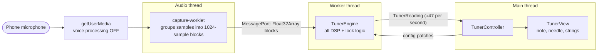
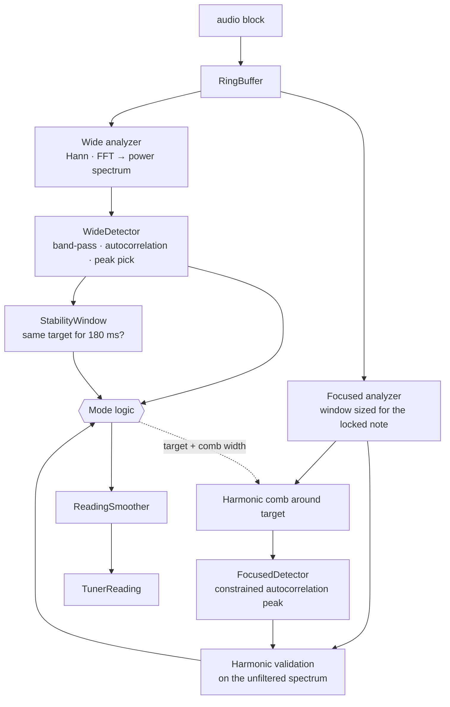
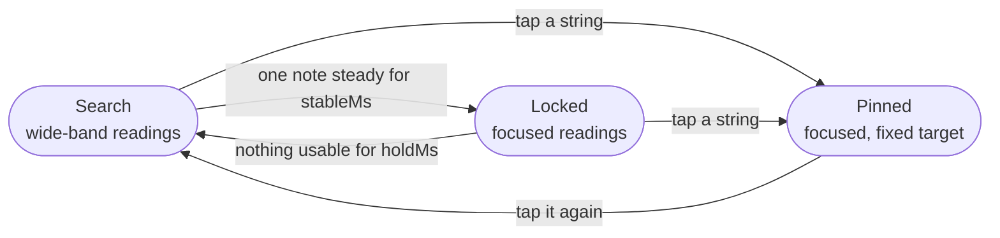

# Tuner architecture

A tuner that listens through the phone microphone. Its distinguishing feature
is the **smart filter**: once it knows which note you are tuning to, it stops
treating the input as "any sound" and starts treating it as "a string that
should be close to this note", which lets it filter and measure far more
aggressively.

- [1. Shape of the system](#1-shape-of-the-system)
- [2. Module map](#2-module-map)
- [3. Signal path](#3-signal-path)
- [4. The smart filter](#4-the-smart-filter)
- [5. Automatic switching](#5-automatic-switching)
- [6. Tunables](#6-tunables)
- [7. What has been verified](#7-what-has-been-verified)
- [8. Limits and next steps](#8-limits-and-next-steps)

## 1. Shape of the system

It is a web app (TypeScript, no framework), so it runs in the browser of any
phone without an app store. Three threads, each with one job:



- The **audio thread** only copies samples. Nothing there can stall capture.
- The **worker** owns all analysis. Audio reaches it directly from the worklet
  through a `MessagePort`, so a busy UI never delays or drops audio.
- The **main thread** only draws. It renders the latest reading once per
  animation frame.

The engine is plain TypeScript with no browser APIs: `process(block) → reading`.
That is what makes it testable in Node and portable to a native shell
(React Native / Capacitor, or a line-by-line port to Kotlin/Swift) where only
the two thin edges — microphone in, UI out — would be rewritten.

Microphone constraints matter: `echoCancellation`, `noiseSuppression` and
`autoGainControl` are all requested **off**. Phone voice processing regards a
sustained string as background noise and removes it.

## 2. Module map

```
public/capture-worklet.js   audio thread: blocks of samples → MessagePort
src/
  audio/MicCapture.ts       AudioContext, getUserMedia, worklet node
  worker/engine.worker.ts   hosts TunerEngine off the main thread
  worker/protocol.ts        message types between main thread and worker
  app/TunerController.ts    façade for the UI: start/stop/configure/readings
  ui/view.ts, styles.css    rendering and input
  main.ts                   wiring, persisted settings, wake lock

  engine/                   ── platform-independent from here down ──
    TunerEngine.ts          orchestration + search/locked state machine
    StabilityWindow.ts      "has one note been sounding steadily?"
    ReadingSmoother.ts      median + exponential smoothing, in-tune detection
    RingBuffer.ts           recent audio history
    config.ts, types.ts     TunerConfig, TunerReading
  dsp/
    fft.ts                  radix-2 FFT
    spectral.ts             windowed power spectrum → filtered autocorrelation
    wideDetector.ts         note-agnostic pitch detector (acquisition, watchdog)
    harmonicComb.ts         string model: comb filter + harmonic validation
    focusedDetector.ts      target-aware pitch detector (tracking)
  music/
    notes.ts                Hz ↔ MIDI ↔ names, cents
    instruments.ts          presets: strings + harmonic model per instrument
    targets.ts              TargetSet: the notes the tuner snaps to
test/                       synthetic plucked strings, DSP and engine scenarios
```

Dependencies point downwards only: `ui → app → worker → engine → dsp, music`.
Nothing in `engine/`, `dsp/` or `music/` touches the DOM or Web Audio.

## 3. Signal path

Every block (1024 samples, ≈21 ms) the engine does this:



Both detectors share one idea, implemented in `dsp/spectral.ts`:

> pitch = position of the autocorrelation peak, where the autocorrelation is
> computed as `IFFT(power spectrum × weights)`.

The **weights are the filter**. The wide detector uses a band-pass over the
instrument's range. The focused detector uses a harmonic comb. Filtering in
the power-spectrum domain costs one multiplication per bin, is zero-phase, and
can be redesigned every frame for free — which is what lets the comb follow
the string as it is tuned.

Two details make the result accurate to a fraction of a cent:

- the frame is shorter than the FFT, so the autocorrelation never wraps around;
- the result is divided by the window's own autocorrelation, otherwise the
  taper drags every peak towards shorter lags (several cents sharp on low notes).

## 4. The smart filter

### What we know before measuring

A string produces partials at near-integer multiples of its fundamental,
stretched slightly by stiffness:

```
f_k = k · f0 · √(1 + B·k²)        k = 1, 2, 3 …
```

`B` (inharmonicity) and the number of useful partials come from the instrument
preset (`HarmonicModel`). And when tuning, `f0` is close to a known target.
So of the whole spectrum, only narrow regions around `k · f_target` can contain
the string. Everything else is, by definition, something else.

### The comb

`buildComb()` creates one pass band per partial:

```
gain
 1 ┤   ┌──┐
   │   │  │        ┌──┐                       band k is centred on f_k(target)
 ¼ ┤   │  │        │  │        ┌──┐           flat over ± widthCents, cosine edges
   │   │  │        │  │        │  │    …      weighted 1/k²
 0 ┼───┴──┴────────┴──┴────────┴──┴─────► Hz
       f1          f2          f3
```

- **Flat top of ± `widthCents`**: a string that is that far off passes
  undistorted, so the filter itself never biases the reading.
- **1/k² weighting**: in an autocorrelation, a partial pulls on the peak
  position in proportion to its power × k². Undoing that keeps the stretched
  upper partials of a stiff string from dragging the reading sharp.
- Bands are padded by the analysis window's main-lobe width; narrower than
  that is physically meaningless for a frame of that length.

### What the lock buys

| Knowing the target lets us… | Effect |
| --- | --- |
| remove everything between the partials | hum, room noise, speech and other strings never reach the estimator |
| search only lags near the target period | octave errors — the classic tuner failure — become impossible |
| size the window for this one note (16 periods) | low strings get a long, precise window; high strings a short, fast one |
| narrow the comb as the string approaches | maximum selectivity exactly when the last few cents matter |

### Keeping it honest

A comb makes *any* input look periodic at the target, so every focused
estimate is checked against the **unfiltered** spectrum (`harmonicProfile()`).
A reading is only valid if all three hold:

| Check | Question | Rejects |
| --- | --- | --- |
| `salience` | Is the band's energy concentrated on the partials, beyond what noise would put there by chance? | silence, noise, a note that has died away |
| `explained` | Of the *tonal* energy (above the measured noise floor), how much do these partials account for? Includes where a lower note's own partials would be. | another string a fourth/fifth away; the tail of a lower string whose 2nd/3rd partial lands near the target |
| `fundamentalSupport` | Is there energy on partials that are *not* multiples of 2, 3, 5, 7? | a note an octave (or twelfth…) *above* the target, all of whose partials fit the comb — e.g. E4 while locked on E2 |

## 5. Automatic switching

Two automatic modes plus a manual pin. The wide detector runs in both automatic modes: as the source of readings while
searching, as a watchdog while locked.



While locked, the target can change without leaving the mode: the lock moves
when another note becomes steady, and hands off to the neighbouring target
when the string is tuned past the midpoint between them.

**Search → Locked.** `StabilityWindow` watches the wide detector. When every
frame in the last `stableMs` (180 ms) is clearly pitched, maps to the same
target, and wanders less than `maxSpreadCents`, that target is "the correct
note": the lock engages and the comb opens just wide enough to contain the
string's current offset. Until then the wide-band reading is shown, so the
display is never blank while the decision is being made.

**While locked**, per frame, in this order (`TunerEngine.trackLocked`):

1. Focused estimate valid, and the wide detector does not steadily report a
   different note → use it. If the wide detector reports an *overtone* of the
   focused pitch, that is its own octave error and is ignored.
2. Wide detector steadily on a different target → move the lock there at once
   (plucking the next string re-targets in about a third of a second).
3. Focused estimate invalid but the wide detector hears something inside the
   capture range → show the wide reading against the locked target (covers a
   string that jumped out of the narrowed comb).
4. Otherwise show nothing. The lock is *held* through silence so re-plucking
   the same string is tracked from the first frame; after `holdMs` (2.5 s)
   the tuner returns to Search.

**Comb width** (`adaptComb`): `|current offset| + marginCents`, bounded by the
target's capture range. It opens instantly, closes gradually, and re-opens
fully after a few frames without a reading.

**Capture range** (`TargetSet.captureCents`): half the distance to the nearest
neighbouring target plus a small overlap — ±80 cents in chromatic mode,
±230–280 cents between guitar strings. The overlap gives hysteresis for the
hand-off when a string is tuned past the midpoint, so the target never flaps.

**User control**

| Control | Config | Behaviour |
| --- | --- | --- |
| Smart filter switch | `smartFilter: 'auto' \| 'off'` | `auto` (default) switches as described. `off` stays wide-band always. |
| Tap a string | `pinnedTargetId` | Forces the lock onto that string with a ±400-cent capture range and ignores every other note. For strings that are far off (new strings) or noisy rooms. Tap again to release. |

Every `TunerReading` carries `mode`, `source` (`wide` / `focused`) and the
lock's target and comb width, so the UI can show exactly what the filter is
doing.

## 6. Tunables

All in `engine/config.ts` (`DEFAULT_CONFIG`). The ones that shape behaviour:

| Setting | Default | Meaning |
| --- | --- | --- |
| `lock.stableMs` | 180 | how long a note must hold before the filter engages |
| `lock.maxSpreadCents` | 30 | how steady it must be during that time |
| `lock.holdMs` | 2500 | silence tolerated before unlocking |
| `focus.marginCents` | 35 | comb half-width when the string is in tune |
| `focus.periods` / `maxFrameMs` | 16 / 150 | focused analysis window |
| `focus.minSalience` / `minExplained` / `minFundamentalSupport` | 0.5 / 0.8 / 0.06 | validation thresholds |
| `wide.minClarity` | 0.85 | periodicity needed for a wide-band reading |
| `display.inTuneCents` / `inTuneHoldMs` | 3 / 400 | when the display turns green |

Instrument knowledge lives in `music/instruments.ts`: adding an instrument or
an alternate tuning is one entry (string notes + harmonic model).

## 7. What has been verified

`npm test` runs 42 tests against a plucked-string synthesizer (inharmonic
partials with individual decay, weak fundamental, white noise, mains hum):

- each guitar string is identified, locked within 0.5 s of the pluck, and read
  to within 0.3 cent;
- on a stiff string (B = 10⁻⁴) the wide detector reads about 3 cents sharp, the
  focused detector under 0.5;
- in noise where wide-band detection fails on more than 15 of 20 trials, the
  focused detector is right on at least 19;
- noise and silence never produce a reading; every other string of the
  instrument is rejected even with the comb fully open;
- E2 ↔ E4, string changes, chromatic hand-off through a semitone, hold and
  release, and pinning behave as described above.

The built app was also driven in headless Chromium with a synthesized
recording as the microphone (worklet → worker → UI), for guitar, chromatic,
pinned and filter-off modes.

The engine takes about 1 ms per 21 ms block in Node on a desktop CPU.

## 8. Limits and next steps

- **Not yet tried on a real phone with a real instrument.** Thresholds were
  set on synthetic signals and will need a pass with recordings; the first
  thing to check is `levelGateDb` and `minClarity` against real phone
  microphones with voice processing disabled.
- **Tonal interference near a partial** (strong mains hum at 100/150 Hz next
  to low E, another instrument playing) biases any estimator. The validation
  rejects such frames rather than show a wrong value, so the needle may drop
  out instead.
- **Inharmonicity is assumed, not measured.** Fitting `B` per string from the
  observed partials would remove the remaining ≈0.5 cent bias.
- **Chromatic mode starts at C2**; basses should use the bass preset, which
  sizes the analysis windows for E1.
- Natural follow-ups: installable PWA (manifest + offline cache), alternate
  tunings, a strobe-style display driven by per-partial phase.
