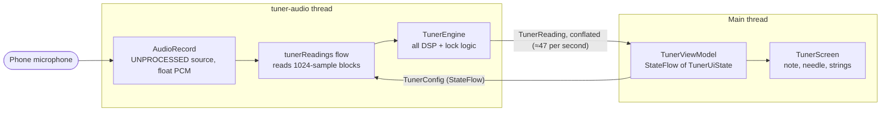
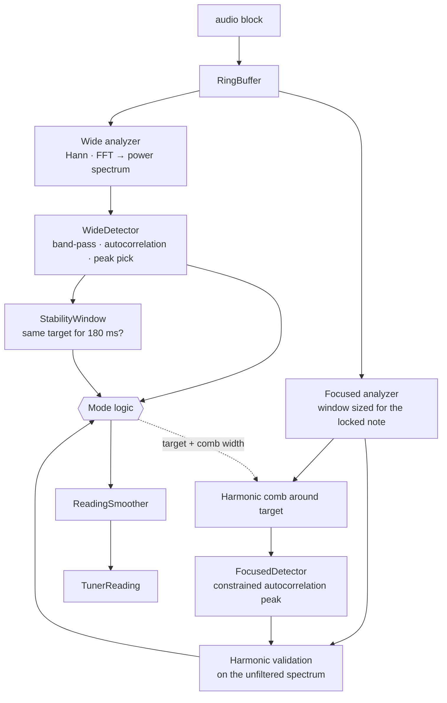

# Tuner architecture

An Android tuner that listens through the phone microphone. Its distinguishing
feature is the **smart filter**: once it knows which note you are tuning to, it
stops treating the input as "any sound" and starts treating it as "a string
that should be close to this note", which lets it filter and measure far more
aggressively.

- [1. Shape of the system](#1-shape-of-the-system)
- [2. Module map](#2-module-map)
- [3. Signal path](#3-signal-path)
- [4. The smart filter](#4-the-smart-filter)
- [5. Automatic switching](#5-automatic-switching)
- [6. Tunables](#6-tunables)
- [7. What has been verified](#7-what-has-been-verified)
- [8. Limits and next steps](#8-limits-and-next-steps)

## 1. Shape of the system

A native Android app in Kotlin, in two Gradle modules:

- **`:engine`** — the tuner itself: DSP, instrument knowledge, and the
  search/lock logic. Pure Kotlin with no Android dependency, so the whole of
  it is unit-tested on the JVM. Its API is one call:
  `TunerEngine.process(block) → TunerReading`.
- **`:app`** — the Android shell: microphone in, Jetpack Compose UI out.

Two threads, each with one job:



- The **audio thread** blocks on `AudioRecord.read`, runs the engine on each
  block, and emits the reading. The engine is single-threaded by design and
  lives entirely here.
- The **main thread** only holds state and draws. The reading stream is
  *conflated*: a slow frame on the UI side means it skips to the newest
  reading, never that analysis waits.
- Configuration travels the other way as an immutable `TunerConfig` in a
  `StateFlow`; the audio loop compares it between blocks. No locks anywhere.

The pipeline is a cold `Flow` (`tunerReadings` in `TunerPipeline.kt`).
Collecting it opens the microphone; cancelling the collection closes it. That
makes the lifecycle hard to get wrong: the view model starts a collection on
"Start" and cancels it on "Stop" or when the app leaves the screen.

### Getting clean audio out of a phone

Phones process microphone audio for speech by default, and that processing is
poison for a tuner: noise suppression regards a sustained string as background
noise and removes it, and automatic gain control pumps the level.
`MicrophoneSource` therefore:

- records from `MediaRecorder.AudioSource.UNPROCESSED` when the device
  supports it, otherwise from `VOICE_RECOGNITION` (the least-processed source
  every device has to provide);
- explicitly switches off any `NoiseSuppressor`, `AutomaticGainControl` or
  `AcousticEchoCanceler` the device still attaches to the recording session;
- reads float PCM at 48 kHz (falling back to 44.1 kHz), mono.

This control over the input is the main reason the app is native rather than a
web page: browsers only *request* that processing be turned off.

## 2. Module map

```
engine/src/main/kotlin/io/github/alfonslm/tuner/
  engine/
    TunerEngine.kt          orchestration + search/locked state machine
    StabilityWindow.kt      "has one note been sounding steadily?"
    ReadingSmoother.kt      median + exponential smoothing, in-tune detection
    RingBuffer.kt           recent audio history
    TunerConfig.kt          every tunable, with defaults
    TunerReading.kt         what the engine reports per block
  dsp/
    Fft.kt                  radix-2 FFT
    Spectral.kt             windowed power spectrum → filtered autocorrelation
    WideDetector.kt         note-agnostic pitch detector (acquisition, watchdog)
    HarmonicComb.kt         string model: comb filter + harmonic validation
    FocusedDetector.kt      target-aware pitch detector (tracking)
  music/
    Notes.kt                Hz ↔ MIDI ↔ names, cents
    Instruments.kt          presets: strings + harmonic model per instrument
    Targets.kt              TargetSet: the notes the tuner snaps to
engine/src/test/            synthetic plucked strings, DSP and engine scenarios

app/src/main/kotlin/io/github/alfonslm/tuner/app/
  audio/AudioSource.kt      interface: something that delivers audio blocks
  audio/MicrophoneSource.kt AudioRecord implementation (see above)
  TunerPipeline.kt          AudioSource + config → Flow<TunerReading>
  TunerViewModel.kt         UI state, start/stop, settings changes
  Settings.kt               persisted choices (SharedPreferences)
  MainActivity.kt           permission, lifecycle, keep-screen-on
  ui/TunerScreen.kt         the screen
  ui/Meter.kt               the cents scale and needle
  ui/Theme.kt               colours
app/src/test/               the pipeline driven by a synthetic microphone
```

Dependencies point one way: `ui → view model → pipeline → engine → dsp, music`.
The app reaches the microphone only through the `AudioSource` interface, which
is what lets the tests replace it with a generated signal.

## 3. Signal path

Every block (1024 samples, ≈21 ms) the engine does this:



Both detectors share one idea, implemented in `dsp/Spectral.kt`:

> pitch = position of the autocorrelation peak, where the autocorrelation is
> computed as `IFFT(power spectrum × weights)`.

The **weights are the filter**. The wide detector uses a band-pass over the
instrument's range. The focused detector uses a harmonic comb. Filtering in
the power-spectrum domain costs one multiplication per bin, is zero-phase, and
can be redesigned every frame for free — which is what lets the comb follow
the string as it is tuned.

Two details make the result accurate to a fraction of a cent:

- the frame is shorter than the FFT, so the autocorrelation never wraps around;
- the result is divided by the window's own autocorrelation, otherwise the
  taper drags every peak towards shorter lags (several cents sharp on low notes).

## 4. The smart filter

### What we know before measuring

A string produces partials at near-integer multiples of its fundamental,
stretched slightly by stiffness:

```
f_k = k · f0 · √(1 + B·k²)        k = 1, 2, 3 …
```

`B` (inharmonicity) and the number of useful partials come from the instrument
preset (`HarmonicModel`). And when tuning, `f0` is close to a known target.
So of the whole spectrum, only narrow regions around `k · f_target` can contain
the string. Everything else is, by definition, something else.

### The comb

`buildComb()` creates one pass band per partial:

```
gain
 1 ┤   ┌──┐
   │   │  │        ┌──┐                       band k is centred on f_k(target)
 ¼ ┤   │  │        │  │        ┌──┐           flat over ± widthCents, cosine edges
   │   │  │        │  │        │  │    …      weighted 1/k²
 0 ┼───┴──┴────────┴──┴────────┴──┴─────► Hz
       f1          f2          f3
```

- **Flat top of ± `widthCents`**: a string that is that far off passes
  undistorted, so the filter itself never biases the reading.
- **1/k² weighting**: in an autocorrelation, a partial pulls on the peak
  position in proportion to its power × k². Undoing that keeps the stretched
  upper partials of a stiff string from dragging the reading sharp.
- Bands are padded by the analysis window's main-lobe width; narrower than
  that is physically meaningless for a frame of that length.

### What the lock buys

| Knowing the target lets us… | Effect |
| --- | --- |
| remove everything between the partials | hum, room noise, speech and other strings never reach the estimator |
| search only lags near the target period | octave errors — the classic tuner failure — become impossible |
| size the window for this one note (16 periods) | low strings get a long, precise window; high strings a short, fast one |
| narrow the comb as the string approaches | maximum selectivity exactly when the last few cents matter |

### Keeping it honest

A comb makes *any* input look periodic at the target, so every focused
estimate is checked against the **unfiltered** spectrum (`harmonicProfile()`).
A reading is only valid if all three hold:

| Check | Question | Rejects |
| --- | --- | --- |
| `salience` | Is the band's energy concentrated on the partials, beyond what noise would put there by chance? | silence, noise, a note that has died away |
| `explained` | Of the *tonal* energy (above the measured noise floor), how much do these partials account for? Includes where a lower note's own partials would be. | another string a fourth/fifth away; the tail of a lower string whose 2nd/3rd partial lands near the target |
| `fundamentalSupport` | Is there energy on partials that are *not* multiples of 2, 3, 5, 7? | a note an octave (or twelfth…) *above* the target, all of whose partials fit the comb — e.g. E4 while locked on E2 |

## 5. Automatic switching

Two automatic modes plus a manual pin. The wide detector runs in both automatic modes: as the source of readings while
searching, as a watchdog while locked.


While locked, the target can change without leaving the mode: the lock moves
when another note becomes steady, and hands off to the neighbouring target
when the string is tuned past the midpoint between them.

**Search → Locked.** `StabilityWindow` watches the wide detector. When every
frame in the last `stableMs` (180 ms) is clearly pitched, maps to the same
target, and wanders less than `maxSpreadCents`, that target is "the correct
note": the lock engages and the comb opens just wide enough to contain the
string's current offset. Until then the wide-band reading is shown, so the
display is never blank while the decision is being made.

**While locked**, per frame, in this order (`TunerEngine.trackLocked`):

1. Focused estimate valid, and the wide detector does not steadily report a
   different note → use it. If the wide detector reports an *overtone* of the
   focused pitch, that is its own octave error and is ignored.
2. Wide detector steadily on a different target → move the lock there at once
   (plucking the next string re-targets in about a third of a second).
3. Focused estimate invalid but the wide detector hears something inside the
   capture range → show the wide reading against the locked target (covers a
   string that jumped out of the narrowed comb).
4. Otherwise show nothing. The lock is *held* through silence so re-plucking
   the same string is tracked from the first frame; after `holdMs` (2.5 s)
   the tuner returns to Search.

**Comb width** (`adaptComb`): `|current offset| + marginCents`, bounded by the
target's capture range. It opens instantly, closes gradually, and re-opens
fully after a few frames without a reading.

**Capture range** (`TargetSet.captureCents`): half the distance to the nearest
neighbouring target plus a small overlap — ±80 cents in chromatic mode,
±230–280 cents between guitar strings. The overlap gives hysteresis for the
hand-off when a string is tuned past the midpoint, so the target never flaps.

**User control**

| Control | Config | Behaviour |
| --- | --- | --- |
| Smart filter switch | `smartFilter: AUTO \| OFF` | `AUTO` (default) switches as described. `OFF` stays wide-band always. |
| Tap a string | `pinnedTargetId` | Forces the lock onto that string with a ±400-cent capture range and ignores every other note. For strings that are far off (new strings) or noisy rooms. Tap again to release. |

Every `TunerReading` carries `mode`, `source` (`WIDE` / `FOCUSED`) and the
lock's target and comb width, so the UI can show exactly what the filter is
doing.

## 6. Tunables

All in `engine/TunerConfig.kt`, as defaults of an immutable data class. The
ones that shape behaviour:

| Setting | Default | Meaning |
| --- | --- | --- |
| `lock.stableMs` | 180 | how long a note must hold before the filter engages |
| `lock.maxSpreadCents` | 30 | how steady it must be during that time |
| `lock.holdMs` | 2500 | silence tolerated before unlocking |
| `focus.marginCents` | 35 | comb half-width when the string is in tune |
| `focus.periods` / `maxFrameMs` | 16 / 150 | focused analysis window |
| `focus.minSalience` / `minExplained` / `minFundamentalSupport` | 0.5 / 0.8 / 0.06 | validation thresholds |
| `wide.minClarity` | 0.85 | periodicity needed for a wide-band reading |
| `display.inTuneCents` / `inTuneHoldMs` | 3 / 400 | when the display turns green |

Instrument knowledge lives in `music/Instruments.kt`: adding an instrument or
an alternate tuning is one entry (string notes + harmonic model).

## 7. What has been verified

`./gradlew test` needs no device. It runs:

- **28 engine tests** against a plucked-string synthesizer (inharmonic
  partials with individual decay, weak fundamental, white noise, mains hum):
  - each guitar string is identified, locked within 0.5 s of the pluck, and
    read to within 0.3 cent;
  - on a stiff string (B = 10⁻⁴) the wide detector reads about 3 cents sharp,
    the focused detector under 1;
  - in noise where wide-band detection fails on more than 15 of 20 trials, the
    focused detector is right on at least 19;
  - noise and silence never produce a reading; every other string of the
    instrument is rejected even with the comb fully open;
  - E2 ↔ E4, string changes, chromatic hand-off through a semitone, hold and
    release, and pinning behave as described above.
- **5 app tests** that drive the real pipeline (view model → flow → engine)
  with a synthetic microphone: a tone gets locked and shown, stopping closes
  the stream, a microphone that fails to open is reported, settings changes
  reach the running engine, settings persist.

`./gradlew :app:validateDebugScreenshotTest` renders the Compose screen on
the JVM in eight states (idle, searching, locked sharp, in tune, held reading,
pinned, chromatic with the filter off, permission denied) and compares them
with the reference images in `app/src/screenshotTestDebug/reference`. After an
intentional UI change, regenerate them with `:app:updateDebugScreenshotTest`.

Debug and release APKs build, and Android lint reports no issues.

What none of this covers is the part that needs hardware: `MicrophoneSource`
has been compiled but never run, and no audio from a real phone microphone has
been through the engine yet.

## 8. Limits and next steps

- **Not yet run on a phone.** Thresholds were set on synthetic signals and
  will need a pass with a real instrument; the first things to check are
  `levelGateDb` and `wide.minClarity` against real phone microphones, and how
  much CPU the engine takes per block on a mid-range device.
- **Tonal interference near a partial** (strong mains hum at 100/150 Hz next
  to low E, another instrument playing) biases any estimator. The validation
  rejects such frames rather than show a wrong value, so the needle may drop
  out instead.
- **Inharmonicity is assumed, not measured.** Fitting `B` per string from the
  observed partials would remove the remaining ≈0.5 cent bias.
- **Chromatic mode starts at C2**; basses should use the bass preset, which
  sizes the analysis windows for E1.
- Natural follow-ups: alternate tunings, a strobe-style display driven by
  per-partial phase, release signing and a Play Store listing.
